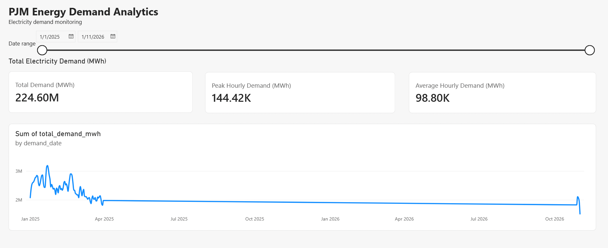

# ⚡ PJM Energy Market Intelligence
### End-to-End AWS Data Engineering Pipeline

An end-to-end data engineering project that ingests hourly electricity demand data from the **U.S. Energy Information Administration (EIA)**, processes it using AWS cloud services, transforms it into analytical data models, and visualizes electricity demand patterns through Power BI.

The project demonstrates **incremental ingestion, Medallion Architecture, distributed data processing, data warehousing, ELT, workflow orchestration, and data quality validation**.

---

## 1. Architecture

```text
                  EIA Open Data API
                         |
                         v
                Python API Ingestion
                - Pagination
                - Retry handling
                - Watermark tracking
                         |
                         v
                Amazon S3 (Bronze)
                     Raw JSON
                         |
                         v
                 AWS Glue (PySpark)
                - Data cleaning
                - Deduplication
                - Type conversion
                         |
                         v
                Amazon S3 (Silver)
                  Parquet Files
                         |
                         v
              Amazon Redshift Serverless
                - COPY into staging
                - MERGE into Silver
                         |
                         v
                    dbt (Gold)
                - Staging models
                - Hourly fact table
                - Daily demand mart
                         |
                         v
                    Power BI
                Interactive Dashboard

       Apache Airflow orchestrates the pipeline
```

### Architecture Overview

The pipeline follows a **Bronze–Silver–Gold architecture**.

| Layer | Technology | Responsibility |
|---|---|---|
| Source | EIA Open Data API | Hourly PJM electricity demand |
| Ingestion | Python, Requests, Boto3 | Extract and ingest data |
| Bronze | Amazon S3 | Store raw JSON |
| Processing | AWS Glue, PySpark | Clean, transform and deduplicate |
| Silver | Amazon S3, Redshift | Store Parquet and structured warehouse data |
| Gold | dbt, Amazon Redshift | Build analytical models |
| Visualization | Power BI | Interactive demand analytics |
| Orchestration | Apache Airflow, Docker | Coordinate pipeline execution |

---

## 2. Technology Stack

**Programming**
- Python
- SQL
- PySpark

**AWS Cloud**
- Amazon S3
- AWS Glue
- Amazon Redshift Serverless
- AWS IAM

**Data Engineering**
- Apache Airflow
- dbt
- Docker
- Parquet
- Medallion Architecture

**Analytics**
- Microsoft Power BI
- DAX

**Development**
- Git
- GitHub

---

## 3. Project Structure

```text
energy-data-platform/
|
|-- airflow/
|   |-- dags/
|   |   |-- eia_daily_pipeline.py
|   |   |-- eia_glue_transform.py
|   |   |-- eia_redshift_loader.py
|   |   |-- eia_daily_ingestion_dag.py
|   |   `-- eia_ingestion_dag.py
|   |-- Dockerfile
|   `-- docker-compose.yml
|
|-- ingestion/
|   `-- ingestion.py
|
|-- transformation/
|   `-- silver/
|       `-- demand_transformation.py
|
|-- sql/
|   |-- load_eia_staging.sql
|   `-- merge_eia_demand.sql
|
|-- dbt/
|   `-- energy_analytics/
|       |-- models/
|       |   |-- staging/
|       |   `-- marts/
|       `-- dbt_project.yml
|
|-- powerbi/
|   `-- PJM_Energy_Demand_Dashboard.pbix
|
|-- docs/
|   `-- screenshots/
|       `-- powerbi_dashboard.png
|
|-- requirements.txt
|-- .env.example
|-- .gitignore
`-- README.md
```

---

## 4. Pipeline Implementation

### Step 1 — Incremental Data Ingestion

Python extracts hourly PJM electricity demand from the EIA API.

Key features:

- REST API integration
- API pagination
- Retry handling
- Incremental extraction
- Watermark-based tracking
- Raw JSON storage in S3

A watermark records the last successfully retrieved timestamp to support subsequent incremental extraction.

**Example S3 Bronze path:**

```text
s3://<bucket-name>/bronze/eia/demand/
    start_date=2025-01-01/
    end_date=2025-01-31/
    demand_2025-01-01T00_2025-01-31T23.json
```

### Step 2 — Data Transformation with AWS Glue

AWS Glue uses PySpark to process raw Bronze data.

Transformations include:

- Parsing JSON
- Standardizing column names
- Converting data types
- Removing duplicate records
- Writing transformed data as Parquet

The Silver dataset is stored in Amazon S3.

**Why Parquet?**

Parquet is a columnar storage format that supports efficient analytical queries and compression.

### Step 3 — Data Loading into Amazon Redshift

The pipeline loads Silver Parquet files into Redshift using a two-stage approach.

**Stage 1: COPY**

Bulk-load Parquet files from S3 into a staging table.

**Stage 2: MERGE**

Upsert records from staging into the target Silver table using the composite business key:

```sql
period_utc, respondent, type
```

This approach supports repeatable loading without creating duplicate records when the same dataset is processed again.

### Step 4 — Analytical Modelling with dbt

dbt transforms warehouse data into analytics-ready Gold models.

| Model | Purpose |
|---|---|
| `stg_eia_demand` | Standardize source data |
| `fct_hourly_demand` | Hourly electricity demand fact table |
| `mart_daily_demand` | Daily demand aggregations |

The daily demand mart supports metrics including:

- Total daily electricity demand
- Peak hourly demand
- Average hourly demand

dbt is also used to execute model tests.

### Step 5 — Workflow Orchestration

Apache Airflow coordinates the complete pipeline.

**Main DAG:** `eia_daily_pipeline`

```text
ingest_eia
    |
    v
run_glue
    |
    v
load_staging
    |
    v
merge_data
    |
    v
run_dbt_gold
```

The pipeline includes retry handling for transient failures.

**Current execution mode:** Manual triggering (`schedule=None`) to control AWS resource usage and costs.

---

## 5. Data Quality Validation

Historical PJM demand data for **January–March 2025** was processed and validated.

### Historical Data Completeness

| Month | Expected Hours | Actual Records | Duplicate Hours | Null Demand |
|---|---:|---:|---:|---:|
| January 2025 | 744 | 744 | 0 | 0 |
| February 2025 | 672 | 672 | 0 | 0 |
| March 2025 | 744 | 744 | 0 | 0 |
| **Total** | **2,160** | **2,160** | **0** | **0** |

Validation checks included:

- Hourly record completeness
- Duplicate timestamp detection
- Null demand detection
- Record count reconciliation

### Idempotency Testing

The Redshift loading process was executed again using the same dataset.

**Result:**

```text
Before rerun: 2,160 records
After rerun:  2,160 records
```

The record count remained unchanged, demonstrating idempotent loading for the validated historical dataset.

---

## 6. Power BI Dashboard

The Power BI dashboard provides interactive analytics for PJM electricity demand.

### Key Metrics

- **Total Demand (MWh)**
- **Peak Hourly Demand (MWh)**
- **Average Hourly Demand (MWh)**

### Dashboard Features

- Daily electricity demand trend
- Date-range slicer
- Interactive KPI cards
- Historical demand analysis

### Dashboard Preview



The dashboard connects to analytical models stored in Amazon Redshift.

Data is currently refreshed manually in Power BI Desktop.

---

## 7. Getting Started

### Prerequisites

- Python 3
- Docker and Docker Compose
- AWS account with configured credentials
- Amazon S3 bucket
- AWS Glue job
- Amazon Redshift Serverless
- dbt
- Power BI Desktop for dashboard viewing

### Clone Repository

```bash
git clone https://github.com/YOUR_USERNAME/energy-data-platform.git
cd energy-data-platform
```

### Configure Environment Variables

Copy the example environment file:

```bash
cp .env.example .env
```

Configure the required variables:

```dotenv
API_KEY=your_eia_api_key
DEMAND_API_URL=https://api.eia.gov/v2/electricity/rto/region-data/data/

AWS_REGION=your_aws_region
BUCKET_NAME=your_s3_bucket_name

REDSHIFT_PASSWORD=your_redshift_password
```

AWS credentials must also be configured through an appropriate AWS credential provider.

### Install Python Dependencies

```bash
python -m venv .venv
source .venv/bin/activate

pip install -r requirements.txt
```

### Start Apache Airflow

```bash
cd airflow

docker compose up -d
```

Open the Airflow web interface using the address configured in Docker Compose.

Locate the DAG:

```text
eia_daily_pipeline
```

Trigger it manually to execute the pipeline.

**Note:** This project requires existing AWS infrastructure, IAM permissions, Redshift configuration and dbt credentials. Cloning the repository alone does not provision those resources.

---

## 8. Engineering Concepts Demonstrated

| Concept | Implementation |
|---|---|
| Incremental ingestion | Timestamp watermark |
| API reliability | Pagination and retries |
| Data lake | S3 Bronze and Silver |
| Distributed processing | AWS Glue with PySpark |
| Columnar storage | Apache Parquet |
| Data warehousing | Amazon Redshift |
| Upsert processing | SQL MERGE |
| Data modelling | dbt |
| Workflow orchestration | Apache Airflow |
| Data quality | Completeness, duplicates, nulls |
| Idempotency | Repeatable Redshift loading |
| Business intelligence | Power BI |

---

## 9. Current Limitations

- Airflow is hosted locally using Docker.
- Pipeline execution is manually triggered.
- Glue currently processes the available Bronze dataset rather than only newly arrived partitions.
- Power BI Desktop requires manual data refresh.
- AWS infrastructure is configured separately rather than provisioned through Infrastructure as Code.

---

## 10. Future Improvements

Potential improvements include:

1. Automated daily Airflow scheduling
2. Airflow failure notifications and monitoring
3. Incremental AWS Glue processing
4. Automated Power BI Service refresh
5. Infrastructure as Code using Terraform
6. CI/CD using GitHub Actions
7. Additional data quality and freshness tests

---

## 11. Project Status

**Completed — End-to-End Working Prototype**

The project has successfully demonstrated:

- EIA API ingestion
- Historical backfill
- S3 Bronze and Silver storage
- AWS Glue transformation
- Redshift warehouse loading
- dbt Gold modelling
- Airflow orchestration
- Power BI visualization
- Historical data quality validation
- Idempotent Redshift loading

---
